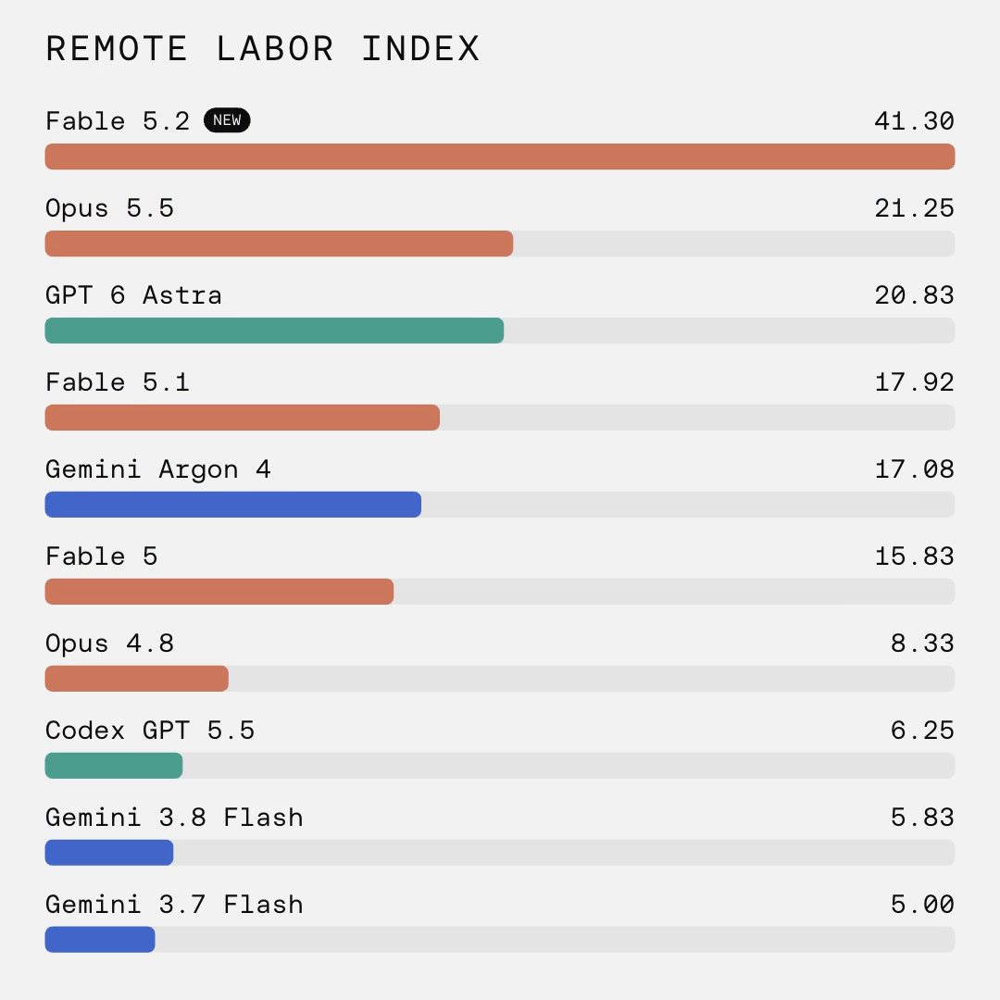

Fable 5.2 finished 99 of 240 real freelance projects at least as well as the professional who was paid for them, in a Remote Labor Index evaluation run by Scale AI and the Center for AI Safety.

That is a genuine jump: 41.3% at high effort, nearly double Claude Opus 5.5's 21.3%. Scale AI said nearly 50 of those wins were projects no earlier agent had completed, and the gains were uneven. Audio and music, architecture and interior design, and 3D modeling moved, while industrial product design and animation remain far from solved. The useful reading is which kinds of remote project work are getting cheaper first.

The same benchmark still leaves 141 projects unsolved, and it leaves out physical work, jobs that need a client in the loop, and long-running work such as SEO. Anthropic's own Economic Index data from June found no systematic rise in unemployment among highly exposed jobs, with only suggestive evidence that hiring of younger workers, aged 22 to 25, in those jobs has slowed.

So the result is real for freelance project work, and still early as a reading of the broader labor market.

Source: https://labs.scale.com/leaderboard/rli and https://www.remotelabor.ai/

