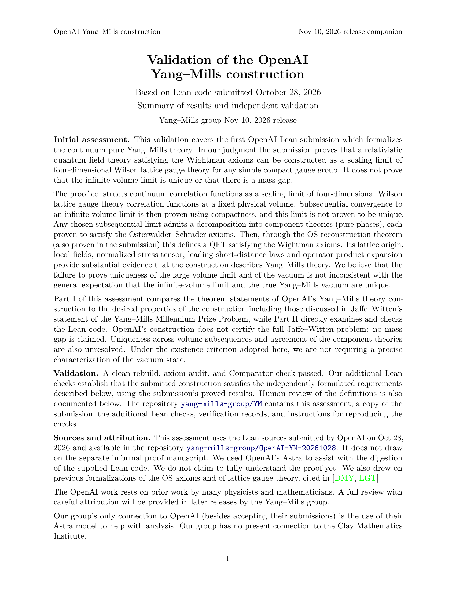

A clean rebuild, an axiom audit, and a Comparator check all passed on OpenAI's Lean formalization of four-dimensional Yang-Mills, submitted on 28 October.

In the judgment of the Yang-Mills Working Group led by David Gross at the Kavli Institute for Theoretical Physics, part of UC Santa Barbara, the code proves that a relativistic quantum field theory satisfying the Wightman axioms can be constructed as a scaling limit of Wilson lattice gauge theory, for any simple compact gauge group. That is a real existence result, and it is worth celebrating.

The assessment is just as clear about what remains open. It leaves a mass gap unproved, and it leaves uniqueness of the infinite-volume limit unproved, which means the Clay Millennium Prize problem is still unsolved. The reviewers write that they used OpenAI's Astra to help read the Lean code, and that they do not claim to fully understand the proof yet.

Machine-checked proofs plus that kind of open human review are the reason to take this seriously.

Source: https://github.com/yang-mills-group/YM/blob/main/docs/assessment-1.pdf

