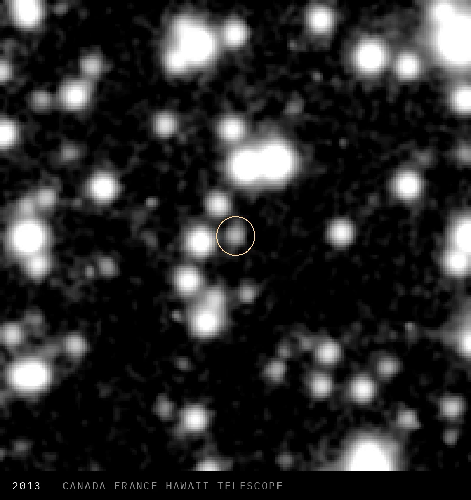

A dwarf planet candidate about 590 km across sat in public telescope images for 12 years, until Joshua Wolk, Will DePue and Luke Farritor tested 50 billion orbits against those archives and one orbit hit.

The models added the capacity to try a novel approach at that scale. The three of them still had to decide where to point it, and how to check the result.

They first found traces of the object in 2025 data from the Rubin Observatory, in a crowded strip of the Milky Way. For a week they could not find it in any older survey, which Wolk called very suspicious. They used Claude for the work, and Anthropic's Fable 5.2 spotted a bug in their orbit code. With the code fixed, the object was there in 2013, 2014, 2015, 2017, 2018 and 2019, in images from the Dark Energy Camera and the Canada-France-Hawaii Telescope.

They asked Mario Juric of Rubin's Solar System team to verify the find. The object is filed with the Minor Planet Center. It is a borderline candidate, because its shape is still unknown, with a likely size of 462 to 707 km depending on how reflective it is, and it does not have a name yet.

Farritor has done this kind of work before. He was the first person to read a word from inside an unopened Herculaneum scroll, using public scans from the Vesuvius Challenge, and later shared the grand prize for recovering longer passages.

When the archives are open, many more people can contribute with novel approaches. AI helps. Judgement still decides where to apply it, and how.

Source: https://www.joshuawolk.com/writing/claude-and-i-found-a-dwarf-planet-candidate

