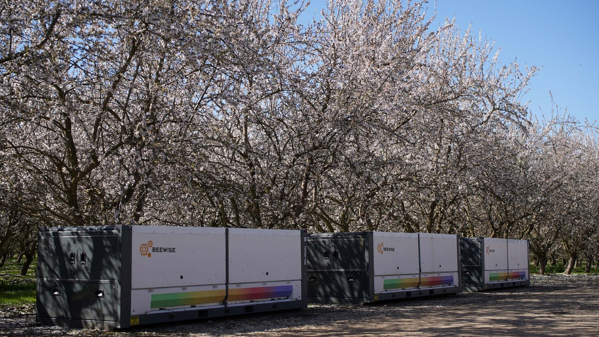
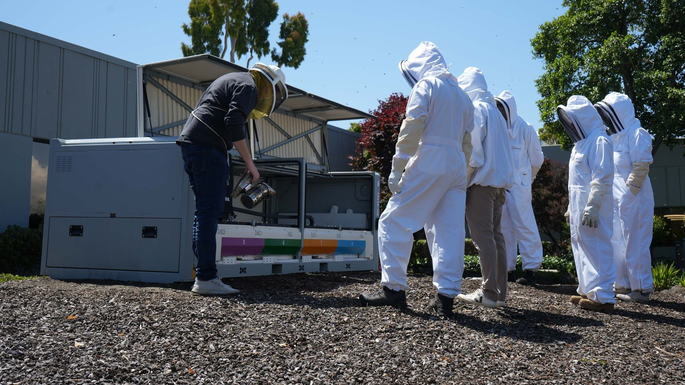
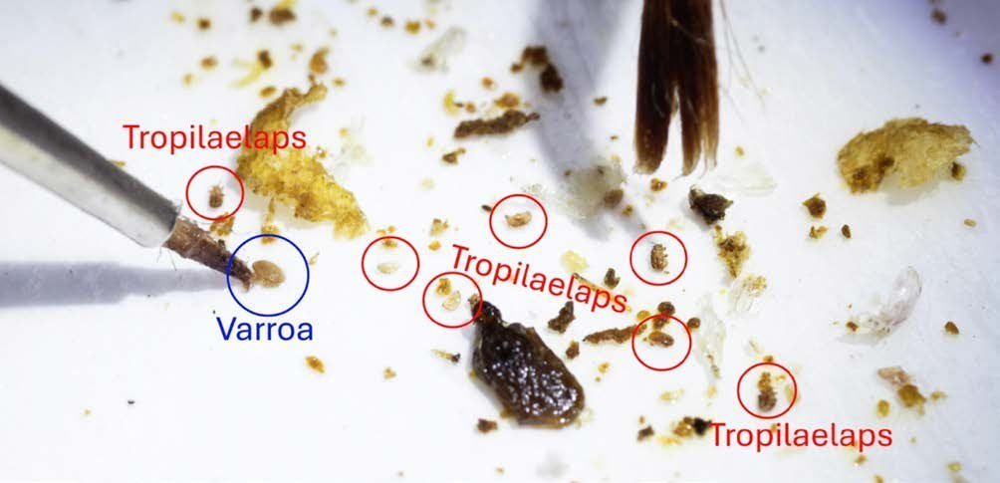
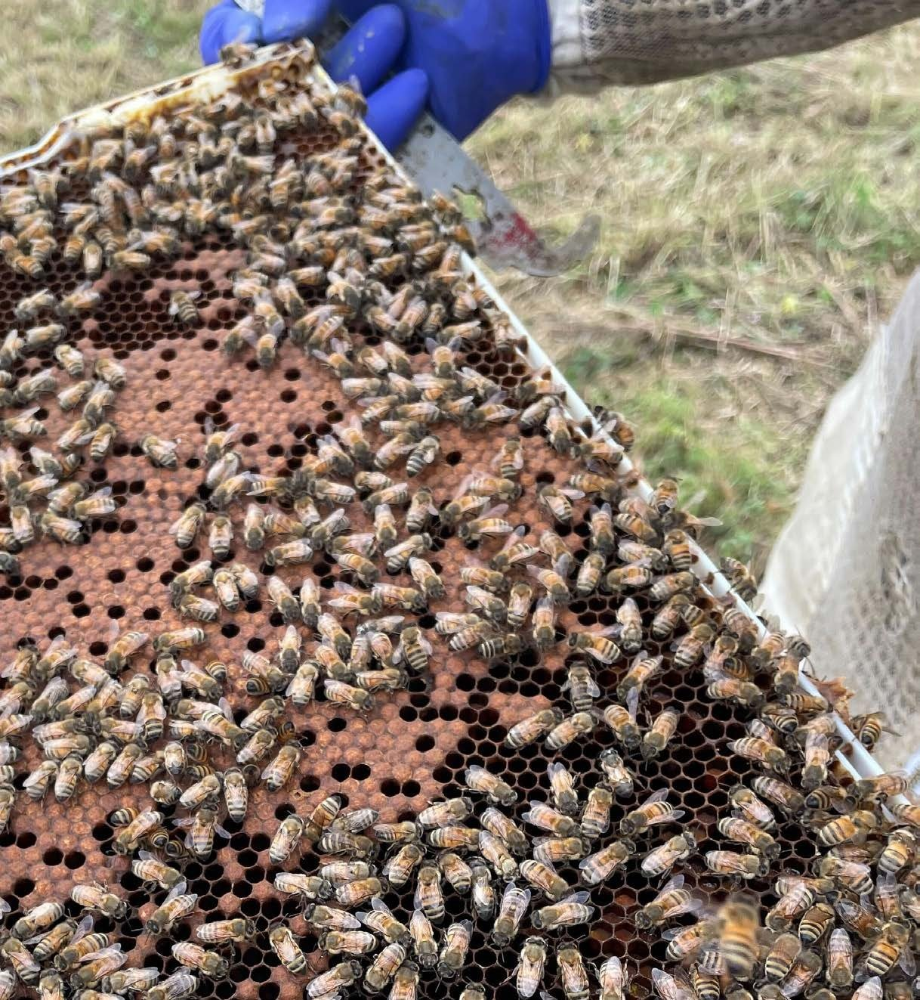

1,925 solar-powered boxes were in the field last year, each holding up to eight bee colonies and a robot arm that does the beekeeping, according to Beewise's 2025 impact report.

It started with a simpler idea. One of the co-founders asked what would happen if he put a camera in every hive. Sensors already existed, and large beekeepers mostly didn't use them, because knowing a hive is sick doesn't help much when your hives are spread across vast distances. So the box had to act as well as watch.

How a BeeHome tends a hive:

1. Cameras and computer vision models check the frames for Varroa mites, without anyone opening the hive.
2. The arm moves frames of capped brood into a heat chamber and warms them to the temperature that kills the mites and leaves the bees unharmed. No chemicals, which matters because USDA researchers traced the 2024 colony collapse to viruses spread by mites resistant to miticides.
3. The box sends mite load, forage activity and colony growth to the beekeeper, who manages it remotely. US beekeepers spend up to 60% of their time traveling to their hives.
4. Next comes ROBI, a solar robot in field trials that drives from hive to hive and does the same work on ordinary hives.

In Beewise's research, the boxes cut annual colony losses by 70% in a year when 42% of colonies were lost.

Monitoring alone got ignored. The version that can act in the field is the one that scaled, and I think that holds for most of physical AI.

Source: https://beewise.ag/hubfs/2025%20Beewise%20Impact%20Report.pdf

