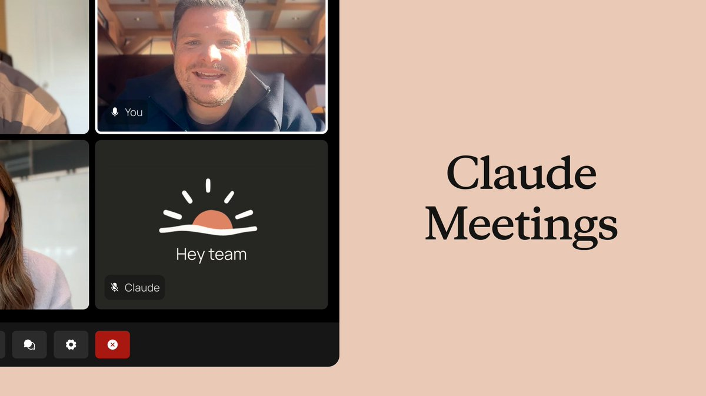

Claude Meetings, announced by Anthropic last night, takes one more niche: the AI meeting notetaker.

I use notetaker apps mostly as data capture. They record and store the conversation, and then I use Claude to pull those notes and correlate them with everything else I'm working on.

With Claude in the call, building the docs and whiteboards while people are still talking, I can skip that step and keep everything in one place.

So what happens to the tools that only capture? I think the value moves to whoever does something with the data. Capture alone is getting hard to sell. It's a beta on Team and Enterprise plans for now, so the switch won't happen overnight, but the direction is clear.

Source: https://x.com/claudeai/status/2120973994191094179

