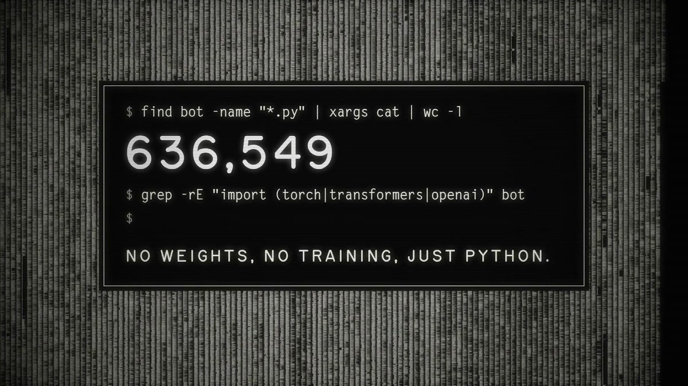

One thousand AI agents spent a week writing 630,000 lines of if-else statements, and the result chats about as well as a 360 million parameter model.

The old joke says AI is just a pile of if-statements. The team at Hugging Face built that pile on purpose. PyBot is a chatbot in plain Python, with no weights and no training, written by a swarm of DeepSeek agents that sent each other around 175,000 messages and merged about 8,000 pull requests.

The funny part gets the attention. The useful part is in Thomas Wolf's write-up. In some runs only 40 to 60 of the 1,000 agents were calling the model at any moment. The rest were waiting for git merges, waiting for tests, or re-reading what other agents had done, at roughly 130 tokens read for every token written.

That is Fred Brooks's old rule about late software projects showing up in a new kind of team. Communication costs grow faster than headcount, for people and for agents.

The models were the cheap part of this experiment. Merge queues, test runs and the way agents talk to each other decide how far a swarm can go, and most of that is ordinary engineering work.

Source: https://github.com/huggingface/pybot

