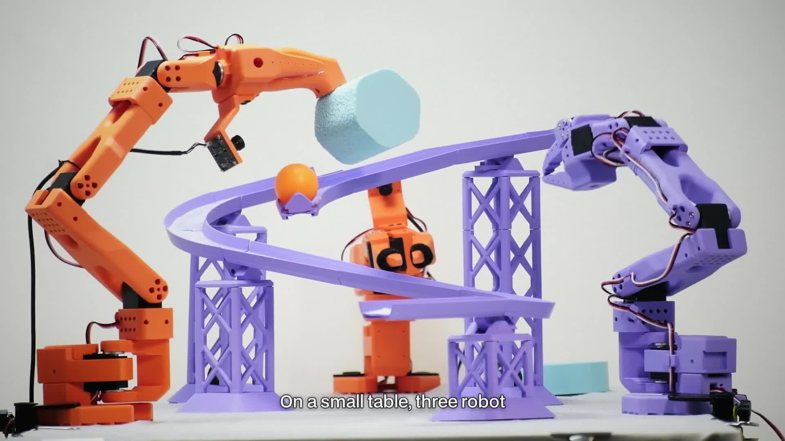

One of these three robot arms has no eyes, one follows a single rule and one learned from 115 human demonstrations, and together they keep an orange ball moving in a loop that never ends.

Echo has no camera and plays back one recorded gesture, the way factory arms have worked for decades. Iris has a camera and one rule, orange and round, and that's enough to catch the ball at the foot of a track and signal Echo to go again. Bandit sits in a bowl of salt where the ball lands somewhere different every time, so a recorded move can't work there. It learned from human-steered demos instead.

Bandit is the slow one. It hovers as if it's making up its mind, dives, comes up holding a pinch of salt and goes back down to try again.

I like this as a picture of where practical robotics is heading. The learned policy only goes where the world is actually unpredictable, and the cheap, predictable parts stay cheap and predictable. I expect most useful systems to look like this table, with old and new methods working around each other's limits.

poobesh, Amey Sharma and Harshit Satija made it as a short nature documentary, built on Seeed Studio's SO-101 arms and Hugging Face's LeRobot.

Source: https://x.com/pbshgthm/status/2122679067065598015

