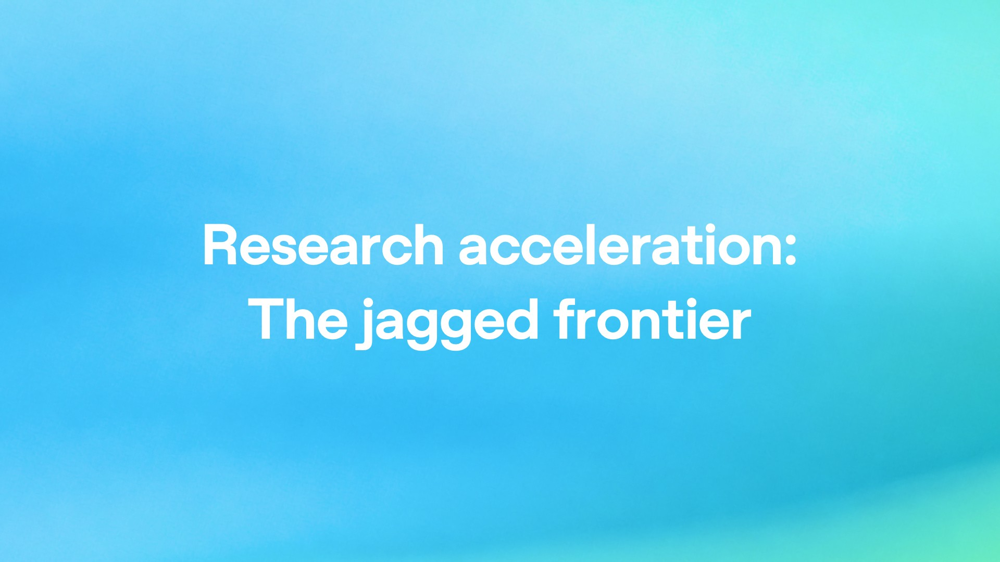

In seven months, the share of two-to-four-hour research tasks that agents finish on their own at OpenAI went from 23% to 46%.

That is the number everyone is sharing from the report OpenAI published last night. The part I found more interesting sits further down.

They asked the researchers behind their last two model releases where the most important ideas came from. For almost all of them, the answer was people, with the models helping to implement. The one exception was pretraining on the latest release, where ideas came out of conversations with Codex and one researcher credited it with a key insight.

The interviews say the same thing in plainer words. Agents write the code, run the experiments and watch the training runs, but researchers say they still have poor taste in ideas. One described the loop as "Go make one. I'll review it and make edits. Then go do the rest."

That matches what I see deploying AI with enterprise teams. Building got much cheaper. Deciding what is worth building, and noticing when the output is quietly wrong, is still where people spend their time.

The number I want in the next report is how many of those key ideas started with a model.

Source: https://openai.com/index/research-acceleration-jagged-frontier/

