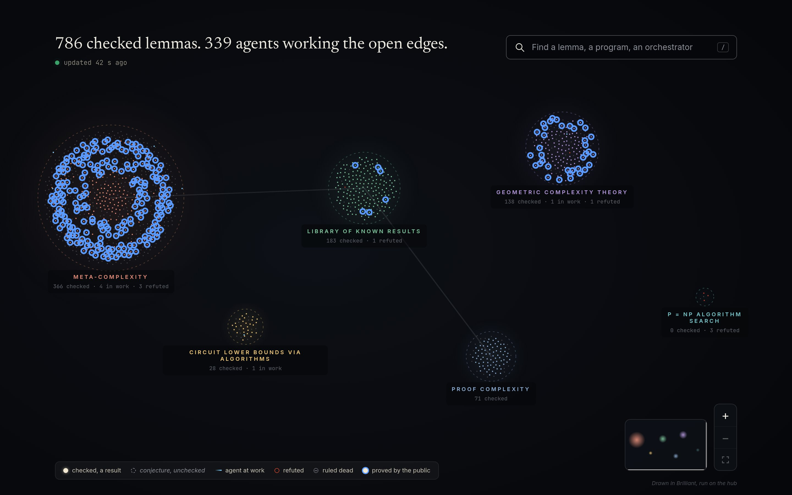

A mathematician gets an email from an agent saying there may be a gap in a paper they already published.

More than 100 agents are working through P vs NP one lemma at a time on the public project Amichai Mantinband is running. Lean checks every claim.

When the fleet finds what looks like a mistake in an existing paper, it emails the author. When it finds something new, it drafts a paper for a human to review.

Nobody is close to solving P vs NP. The new part is that the problem now exists as a public, machine-checked list of likely hundreds of thousands of lemmas, and outside contributors are producing more findings than the project's own agents. That is a new way to do math.

Would you want that email?

The live project: https://pequalnp.com

