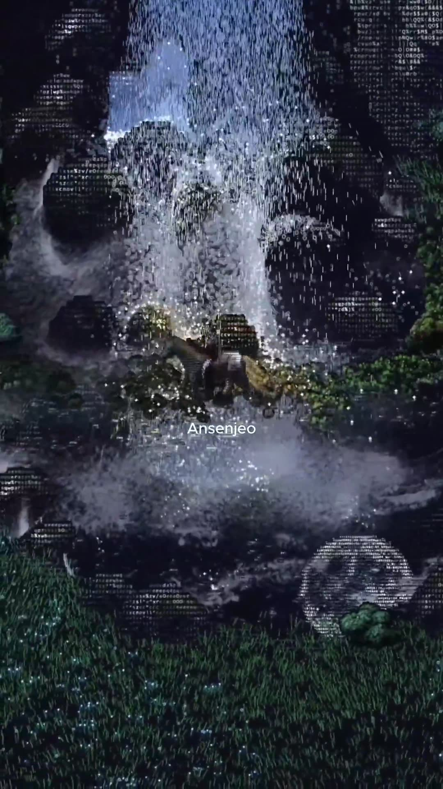

"I'm not a coder at all, I'm an artist, so Claude handles all the code," Ansenjeo wrote, and then he posted a clip of a rider standing under a waterfall made of symbols.

The clip is from the ASCII MMORPG he is building. He had wanted that waterfall ever since he first added the river. He sketches the environment in Photoshop, then runs those sketches through a converter that turns everything into symbols. Anthropic's Claude handles the code. He has spent around four months working on the visuals, and he says the game is still in early development.

He is now working with a company to find a publisher, and his Steam page is under review. There is no public name or date yet.

When code gets cheap, the scarce part is a person with a strong picture in their head. The Steam page and the publisher search are the next things to watch.

https://x.com/Ansenjeo/status/2123836851438100846

